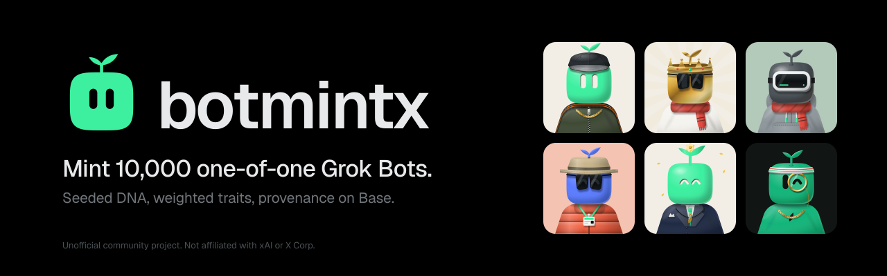
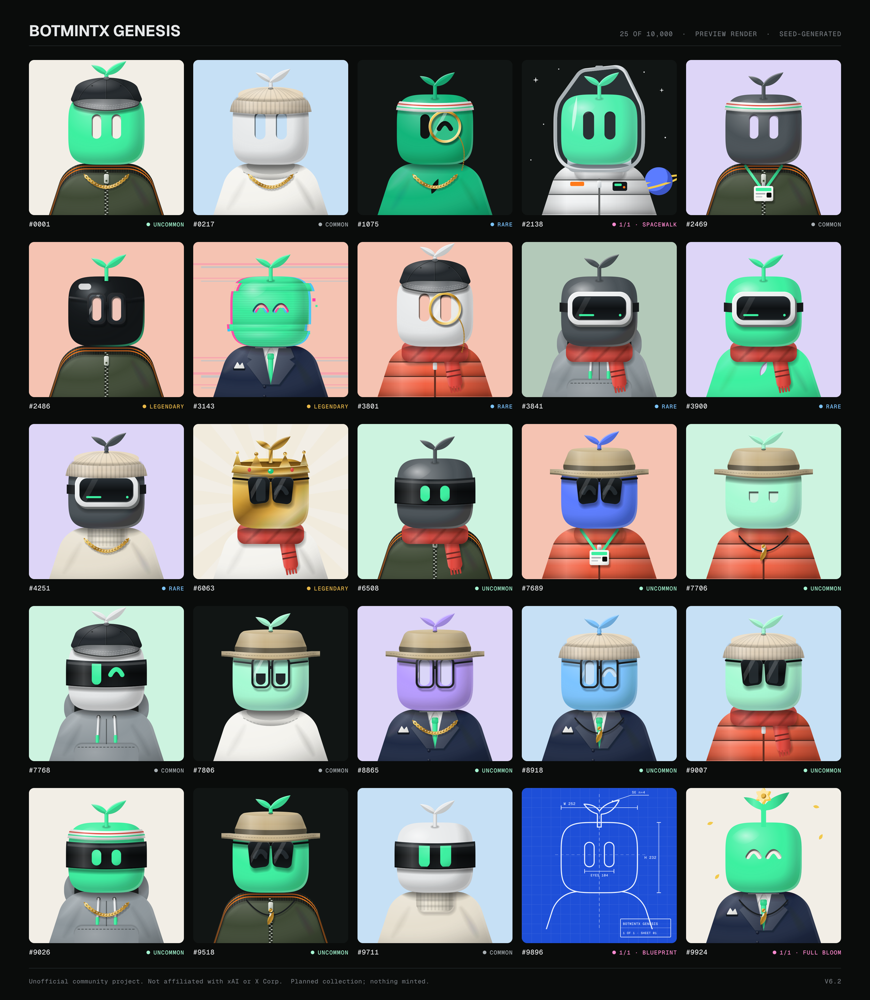
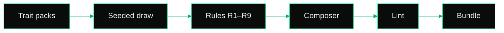
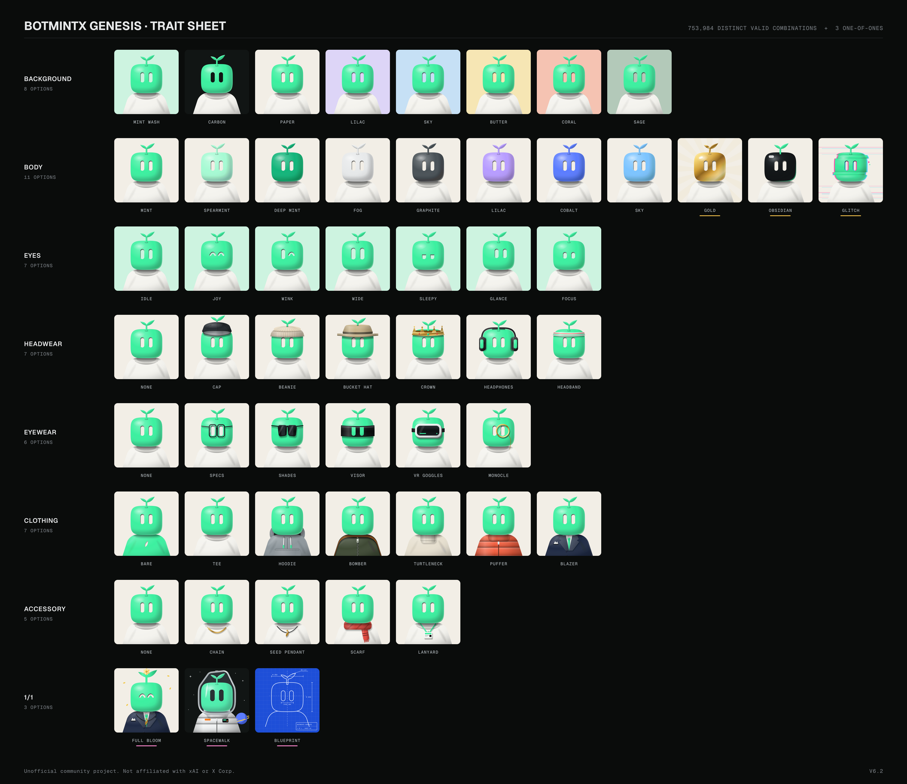

<div align="center">

<picture>
  <source media="(prefers-color-scheme: dark)" srcset=".github/assets/banner-dark.svg">
  <source media="(prefers-color-scheme: light)" srcset=".github/assets/banner-light.svg">
  
</picture>

<br/><br/>

<a href="LICENSE"></a>


<a href="CONTRIBUTING.md"></a>

<h3>A generative engine that renders Grok Bot templates from weighted traits and seeded DNA.</h3>

<sub>HashLips-style layers · seeded weights · deterministic DNA · 173 billion valid templates</sub>

<br/>

[Quick start](#quick-start) · [How it works](#how-it-works) · [PFPs](#genesis-pfps) · [Traits](#trait-layers) · [Genesis](#genesis) · [Mint with X Money](#mint-with-x-money) · [Gallery](#gallery)

</div>

---

> [!IMPORTANT]
> **Unofficial community project. Not affiliated with xAI or X Corp.**
> "Grok", "X", and "X Money" refer to third-party products and are used here only to describe compatibility.

**botmint** works like an NFT art generator, but the output is a bot. It stacks behavior layers, draws them with a seeded PRNG, and writes a Grok Bot template: name, job, policy, skills, one routine, connectors, and a DNA avatar.

The starter packs (`core`, `markets`, `creator`) produce **19,535** valid cores and **173,283,264,000** valid templates. DNA ignores output style and avatar style, so the DNA space is **2,406,712,000**. `botmint count --json` prints those integers.

**Botmintx** is the org. **`botmint`** is the engine and the CLI. **Genesis** is the planned drop of 10,000 bots, `#0001`–`#10000`. It is not frozen. Claims are closed. Nothing in this repo calls xAI, Base, or X Money.

<p align="center"></p>

## Quick start

Node 24 and pnpm 10.33.4.

```bash
git clone https://github.com/botmintx/botmint
cd botmint
pnpm install
pnpm exec botmint count --json
pnpm exec botmint validate
pnpm exec botmint render dev-sample "#0001"
pnpm --filter @botmint/gallery build
```

`collections/dev-sample/` is 25 raw bots from seed `botmint-dev-sample-001`. It is not Genesis.

Useful commands (there is no `botmint roll`):

```bash
pnpm exec botmint drop build dev-sample --seed botmint-dev-sample-001 --count 25
pnpm exec botmint drop stats dev-sample
pnpm exec botmint export dev-sample "#0001" --format install
pnpm exec botmint mint nonce genesis random
pnpm exec botmint verify --collection genesis
pnpm exec botmint polish dev-sample --dry-run
```

`polish` without `--dry-run` needs `--i-understand-this-costs-money` and `XAI_API_KEY`. It refuses when `CI=true`. This repository never sets that key. `anchor` prints an unsigned transaction and does not send it.

## How it works



| Piece | Where | What it does |
| --- | --- | --- |
| Registry | `@botmint/core` | Loads packs, rejects unknown keys and missing ids. |
| Sampler | `@botmint/core` | sfc32, then a weighted pick. No `Math.random`. |
| Solver | `@botmint/core` | Draws only legal candidates, repairs skill coverage, retries on duplicate DNA or low coherence. |
| Composer | `@botmint/composer` | Handlebars, logic-less, into every recipe field. |
| Lint | `@botmint/lint` | Schema, secrets, cron window, locked policy, X Money sentences. |
| Exporters | `@botmint/exporters` | `recipe.json`, skills, routine, memories, `INSTALL.md`, card, DNA `avatar.svg`, zip. |
| Polish | `@botmint/polish` | xAI client, tested on a mock. Not run for real here. |
| Chain | `@botmint/chain` | EAS schema strings and unsigned txs. |
| Claims | `@botmint/claims` | Note parser, assignment, refunds. No payment client. |
| CLI | `botmint` | The commands above. |
| Gallery | `apps/gallery` | Next.js static export of the dev sample. Not deployed. |

## Genesis PFPs

The mascot is a mint squircle with cut-out capsule eyes and a two-leaf sprout. No outline, no mouth. The art is final (v6.2).

| Layer | Options |
| --- | --- |
| Background | Mint Wash, Carbon, Paper, Lilac, Sky, Butter, Coral, Sage |
| Body | Mint, Spearmint, Deep Mint, Fog, Graphite, Lilac, Cobalt, Sky, Gold, Obsidian, Glitch |
| Eyes | Idle, Joy, Wink, Wide, Sleepy, Glance, Focus |
| Headwear | None, Cap, Beanie, Bucket Hat, Crown, Headphones, Headband |
| Eyewear | None, Specs, Shades, Visor, VR Goggles, Monocle |
| Clothing | Bare, Tee, Hoodie, Bomber, Turtleneck, Puffer, Blazer |
| Accessory | None, Chain, Seed Pendant, Scarf, Lanyard |

**753,984** valid looks, plus **3** one-of-ones (Full Bloom, Spacewalk, Blueprint). Turtleneck + Scarf is invalid. VR Goggles collapse Eyes to Idle. Tiers: Legendary body (Gold, Obsidian, Glitch) 205,632 · Rare (Crown, VR Goggles, Monocle) 182,784 · Uncommon 206,080 · Common 159,488.

The TypeScript port lives in [`packages/avatars`](packages/avatars/). Python in `src/python` stays the art reference. Mint weights for these looks are not set. Dev-sample cards use the DNA avatar from the recipe, not a PFP roll.

<p align="center"></p>

## Trait layers

Behavior layers, in draw order. Weights in each layer sum to 100.

| Layer | Pick | Pack |
| --- | --- | --- |
| Archetype | 1 of 13 | core, markets, creator |
| Domain | 1 of 15 | core, markets, creator |
| Connectors | 2 of 11 | core, markets, creator |
| Autonomy | 1 of 4 | core |
| Persona | 1 of 10 | core |
| Skills | 3 of 22 | core, markets, creator |
| Cadence | 1 of 8 | core |
| Output | 1 of 6, not in DNA | core |
| Avatar style | 1 of 12, not in DNA | core |

The name is `<adjective> <noun> - <domain> <archetype title>`. Rarity tiers for a drop of size N use floors of 1%, 5%, 15%, and 40%. Details are in [docs/rarity.md](docs/rarity.md) and [docs/rules.md](docs/rules.md).

## Genesis

Not frozen. `collections/genesis/` has a readme and `claims/claims.state.json` with `"open": false`. Raw and polished output are gitignored until the runbook in [docs/genesis.md](docs/genesis.md).

| | |
| --- | --- |
| Supply | 10,000. Not rendered in this repo. |
| Seed | Chosen at freeze. Not published yet. |
| Polish | Tooling exists. The paid pass has not been run. |
| Provenance | Computed for the dev sample only. |
| Anchor | Unsigned EAS builders. Not sent. See [docs/anchoring.md](docs/anchoring.md). |
| Verify | `botmint verify --collection genesis` reports that Genesis is not frozen. |

## Mint with X Money

$10 per Genesis number, for eligible customers in the United States. A claim is a registry row, not an NFT. Installing a template is free.

The minter and Mint Desk skills are in [`integrations/x-money`](integrations/x-money/). They are text. This CLI has no X Money client and does not send, request, or read payments.

`botmint mint nonce` prints the payee `@brandononchain` and a note. Claims stay closed. The refund note in [docs/refunds.md](docs/refunds.md) is a draft and is not in effect. Collectors outside X Money can use the Genesis waitlist issue form.

## Gallery

`apps/gallery` is a Next.js 15 static export. `GALLERY_COLLECTION` for this pass is the dev sample. Every page shows the dev-sample banner and the footer line. The mint controls render disabled. Build it with `pnpm --filter @botmint/gallery build`. The `out/` directory is local. Nothing is deployed. `gallery-deploy.yml` is `workflow_dispatch` with the job forced off.

## Repo

```text
packages/core  composer  exporters  lint  polish  chain  claims  cli  avatars
apps/gallery
packs/core  packs/markets  packs/creator
integrations/x-money
collections/dev-sample
collections/genesis   # not frozen
```

License: MIT, [Brandon M. Crenshaw and botmint contributors](LICENSE). Brand rules: [.github/BRAND.md](.github/BRAND.md).
